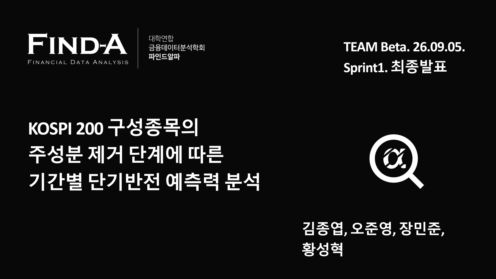

# KOSPI200 PCA Reversal

**PCA 공통요인 제거와 단기반전 예측력**
TEAM Beta · **김종엽 · 오준영 · 장민준 · 황성혁**

[발표 미리보기](PRESENTATION.md) · [PowerPoint 다운로드](reports/sprint1_beta_final.pptx) · [연구 코드](research/)

## 연구 질문

KOSPI200 구성종목의 단기반전 신호를 검정하고, 주성분을 제거한 잔차 신호가 원수익률 신호보다 예측력이 높은지 비교한다. 신호 검정 이후에는 거래비용을 반영한 포트폴리오 성과를 평가한다.

| 대상 | 설계 |
|---|---|
| 데이터 | 2008–2026년 편입 이력 407종목 · 시점별 편입 마스크 |
| PCA 학습 | 60 / 120 / 252거래일 · T 이전 관측치로 추정 |
| 과거 신호 | 5 / 10 / 30 / 60거래일 수익률 |
| 미래수익률 | 5 / 10 / 20 / 60거래일 · Rank IC 비교 |

## 주요 결과

| 지표 | 발표 결과 |
|---|---:|
| 양의 Rank IC | 155 / 160 |
| BH 보정 후 유의한 Rank IC | 96 / 160 |
| 평균 ΔIC | −0.00348 |
| 유의한 양의 PCA 개선 | 0 / 144 |
| 비용 반영 QIC 롱숏 CAGR | −6.20% |
| 비용 반영 QIC 롱온리 CAGR | 1.12% |

단기반전 신호는 관찰됐지만 PCA 제거에 따른 개선은 확인되지 않았다. QIC 전략의 비용 차감 후 성과도 시장을 하회했다. 아래 수치는 기존 공동 발표의 결과다.

## 코드 구성

입력과 실행 의존성

`02_build_pca_pre_signal_common252_dataset.py` → `05_build_future_log_returns_5_10_20_60.py` → `IC만들기/06_build_state_ic_train_library.py` 순으로 입력이 연결된다. 13–20번 파일은 각각 다른 포트폴리오 실험이며 단일 연속 파이프라인이 아니다.

입력은 분석·QC Excel이며 공개 저장소에는 포함되지 않는다. 경로 의존성 때문에 `research/` 계층이 필요하다. 전체 파이프라인의 새 환경 재현은 미검증 상태다.

개인별 기여 범위는 별도로 구분하지 않은 공동 연구다. [데이터 범위](DATA_POLICY.md)
