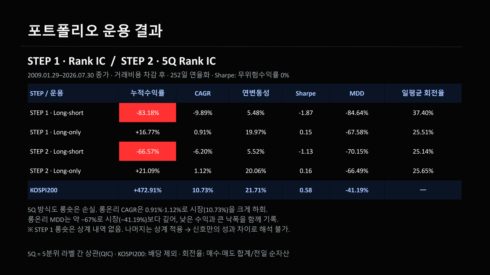

# KOSPI200 단기반전과 PCA

PCA로 시장 공통요인을 제거하면 단기반전 신호의 예측력이 높아지는지 비교한 공동연구입니다.

**TEAM Beta** · 김종엽, 오준영, 장민준, 황성혁  
[발표 보기](PRESENTATION.md) · [PowerPoint](reports/sprint1_beta_final.pptx) · [연구 코드](research/)

## 결과

단기반전 신호는 관찰됐지만, PCA를 적용한 신호가 원수익률 신호보다 낫다는 증거는 얻지 못했습니다. QIC 전략의 거래비용 차감 후 성과도 시장을 하회했습니다.

| 지표 | 공동 발표 결과 |
|---|---:|
| 양의 Rank IC | 155 / 160 |
| BH 보정 후 유의한 Rank IC | 96 / 160 |
| 평균 ΔIC | −0.00348 |
| 유의한 양의 PCA 개선 | 0 / 144 |
| 비용 차감 후 QIC 롱숏 CAGR | −6.20% |
| 비용 차감 후 QIC 롱온리 CAGR | 1.12% |

Rank IC는 신호와 미래수익률의 순위 상관계수, CAGR은 연평균 복리수익률입니다. 위 수치는 기존 공동 발표자료를 기준으로 정리했습니다.

## 분석 설계

| 항목 | 설정 |
|---|---|
| 종목 | 2008–2026년 KOSPI200 편입 이력 407종목 |
| 편입 기준 | 시점별 편입 마스크 사용 |
| PCA 학습 구간 | 60 / 120 / 252거래일, 판단 시점 T 이전 자료 |
| 과거 수익률 | 5 / 10 / 30 / 60거래일 |
| 미래수익률 | 5 / 10 / 20 / 60거래일 |

원수익률과 PCA 잔차로 신호를 만들고 미래수익률과의 Rank IC를 비교했습니다. 이후 모델 선택과 비용 반영 포트폴리오 평가를 진행했습니다.

## 코드와 입력

| 순서 | 파일 | 역할 |
|---|---|---|
| 1 | `02_build_pca_pre_signal_common252_dataset.py` | PCA 잔차·과거 신호 |
| 2 | `05_build_future_log_returns_5_10_20_60.py` | 미래수익률 |
| 3 | `IC만들기/06_build_state_ic_train_library.py` | IC 학습 자료 |

위 파일은 [research/](research/) 아래의 기존 디렉터리 구조를 기준으로 연결됩니다. 13–20번 파일은 서로 다른 포트폴리오 실험이므로 번호순으로 모두 실행하는 구조는 아닙니다.

입력으로 사용한 분석·QC Excel은 공개하지 않습니다. 전체 과정을 새 환경에서 재실행하는 검증은 아직 완료하지 않았습니다.

## 연구 범위

공동 발표자료와 실험 코드를 정리한 저장소입니다. 개인별 기여 범위는 별도로 구분하지 않았습니다.

[발표 주요 페이지](PRESENTATION.md) · [데이터 범위와 재현 조건](DATA_POLICY.md)
